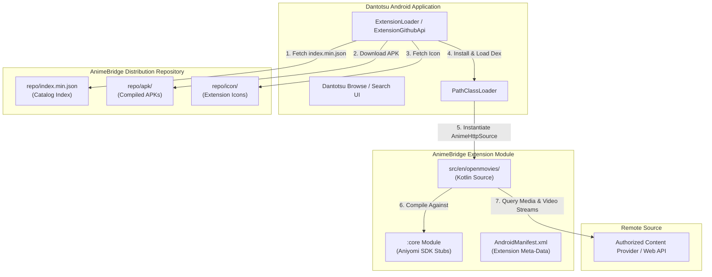
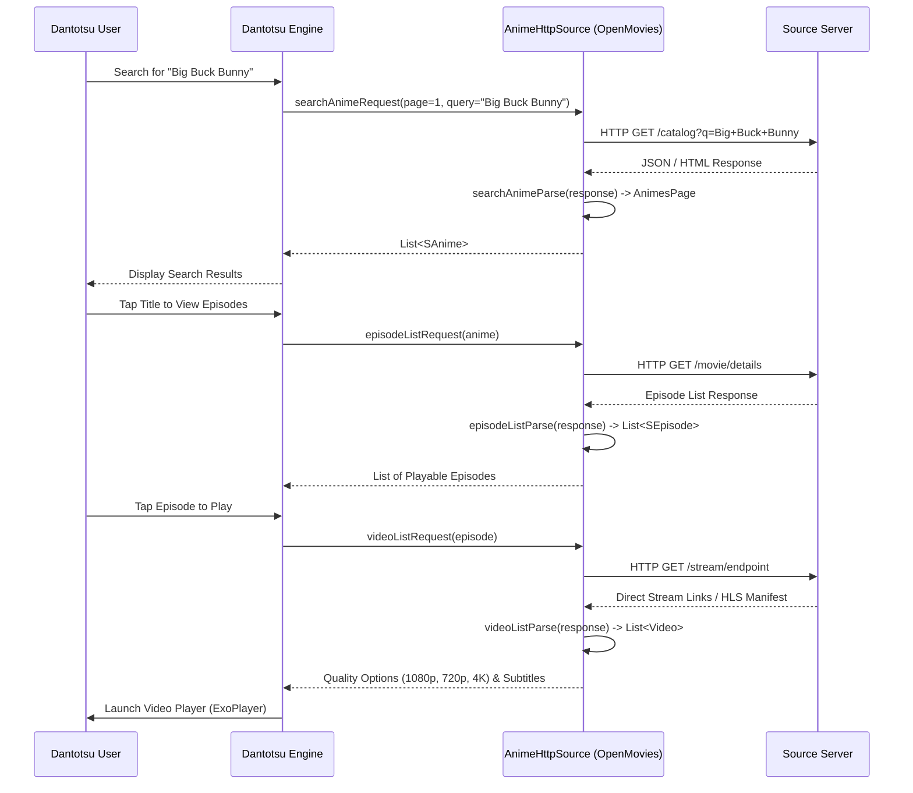

# AnimeBridge Architecture & Design Specification

> **Target System:** Dantotsu / ReDantotsu Android Client  
> **Runtime Environment:** Aniyomi Anime Extension SDK (JVM / Dalvik Executable / Android DEX)  
> **Repository Protocol:** Aniyomi v1/v2 Static JSON Index Protocol  

---

## 1. System Overview

AnimeBridge is a modular, decentralized repository of website extensions engineered specifically for **Dantotsu** and compatible Aniyomi-ecosystem Android media clients.

Unlike generic web scraping proxies, Dantotsu executes extensions **locally on the user's Android device**. Each extension is an independent, compiled Android application package (APK) implementing the Aniyomi `AnimeHttpSource` or `ParsedAnimeHttpSource` abstract interfaces.



---

## 2. Component Architecture

### 2.1 The `:core` Module (SDK Contracts)
Located in `core/`, this module supplies the authoritative Aniyomi interface definitions:
- **`AnimeSource` / `AnimeCatalogueSource`**: Base contracts for pagination, searching, and metadata.
- **`AnimeHttpSource`**: HTTP-driven base class with preconfigured `OkHttpClient`, standard headers, and request-builder lifecycle methods.
- **`ParsedAnimeHttpSource`**: Jsoup-enabled base class for DOM/CSS-selector extraction.
- **Models**:
  - `SAnime`: Canonical title, synopsis, status, genres, author, and poster URL.
  - `SEpisode`: Episode title, float episode number, release timestamp, and content URL.
  - `Video`: Direct playable stream URL, resolution label (`1080p`, `720p`, `4K`), HTTP headers, and subtitle tracks.
  - `Track`: Subtitle or secondary audio track URL and ISO language identifier.

### 2.2 Extension Modules (`src/<lang>/<extension>/`)
Each source integration lives in its own dedicated multi-project module:
```text
src/
└── en/
    └── openmovies/
        ├── AndroidManifest.xml       # Required Dantotsu manifest metadata
        ├── build.gradle.kts          # Gradle build script (AGP application plugin)
        ├── manifest.json             # Registry metadata descriptor
        ├── res/
        │   └── mipmap-xxxhdpi/
        │       └── ic_launcher.png   # 512x512 square extension icon
        └── src/
            └── eu/kanade/tachiyomi/animeextension/en/openmovies/
                └── OpenMovies.kt     # Concrete AnimeHttpSource implementation
```

### 2.3 Shared Utility Libraries (`lib/`)
Shared extractors (such as `lib/playlistutils`) provide reusable logic for parsing HLS (`.m3u8`) playlists and video embed hosts without duplicating code across extensions.

---

## 3. Extension Runtime Contract & Lifecycle

When a user searches or streams media in Dantotsu, the application executes the following lifecycle calls inside the loaded extension:



---

## 4. Repository Index Protocol

Dantotsu polls the repository index URL (`https://.../index.min.json`). The registry pipeline compiles this deterministically:

1. **Validation**: All manifests under `src/` are validated against `src/manifest.schema.json`.
2. **LibVersion Verification**: Confirms version code follows `<libVersion>.<extVersion>` with `libVersion` strictly within `12`–`15` (or up to `16` in modern builds).
3. **Artifact Sync**: APK files are compiled/packaged into `repo/apk/` and icons are synchronized to `repo/icon/<pkg>.png`.
4. **Deterministic Serializer**: Entries are sorted alphabetically by package ID (`pkg`) and serialized without arbitrary whitespace or random ordering into `repo/index.min.json`.

---

## 5. Security & Legal Boundaries

1. **Local Execution**: All requests originate directly from the user's device. No intermediate proxies or scraping proxies are utilized.
2. **Authorization Prerequisite**: Extensions are only developed for sources where data access is lawful, open, or explicitly permitted by terms.
3. **No Circumvention**: DRM decryption (Widevine/FairPlay), CAPTCHA solving bypasses, and paywall circumvention are prohibited.
4. **Secrets Isolation**: No user tokens, passwords, or private signing keys are embedded in source code.
