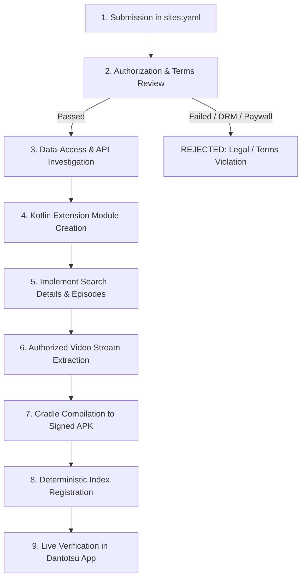

# Website Integration Queue & Evaluation Process

> **CRITICAL ARCHITECTURAL PRINCIPLE:**
> **Adding a website name and homepage URL to a configuration file or queue DOES NOT implement an integration in Dantotsu.**
> 
> Dantotsu does not use generic URL wrappers. Every website integration requires an independent, compiled Kotlin Android extension conforming to the Aniyomi `AnimeHttpSource` or `ParsedAnimeHttpSource` SDK interface.

---

## 1. Integration Request & Evaluation Lifecycle

Every prospective source website submitted by contributors must undergo a strict 9-step evaluation pipeline before any code is merged or published to the repository index:

### Step-by-Step Breakdown:

1. **Submission in `config/sites.yaml`**:
   The prospective site is registered with status `beta` or `demo` and `enabled: false`. Adding a URL here only registers an integration request.
2. **Authorization & Legal Terms Review**:
   Verify source authorization: public domain, Creative Commons, authorized developer partnership, or public data-access rights. Strictly reject sites requiring authentication bypass, DRM circumvention, paywall evasion, or copyright infringement.
3. **Data-Access Investigation**:
   Determine whether the source exposes an official JSON/REST API or requires HTML parsing via Jsoup.
4. **Dedicated Kotlin Extension Module Creation**:
   Create a dedicated module in `src/<lang>/<source_id>/` with its own `build.gradle.kts` and `AndroidManifest.xml`.
5. **Implement Core Capabilities**:
   Inherit from `AnimeHttpSource` or `ParsedAnimeHttpSource`. Implement `popularAnimeRequest/Parse`, `searchAnimeRequest/Parse`, `animeDetailsParse`, and `episodeListParse`.
6. **Authorized Video Retrieval**:
   Extract direct streams, HLS playlists (`.m3u8`), and subtitle tracks (`Track`) where authorized.
7. **Gradle APK Compilation**:
   Compile the module using `./gradlew :src:<lang>:<name>:assembleRelease`. Validate that package ID adheres to `eu.kanade.tachiyomi.animeextension.<lang>.<name>` and version matches `<libVersion>.<extVersion>`.
8. **Repository Registry Publication**:
   Run `python scripts/build_registry.py` to validate manifests, package artifacts into `repo/apk/` and `repo/icon/`, and generate `repo/index.min.json`.
9. **Dantotsu Device Verification**:
   Install the APK on an Android device running Dantotsu. Verify catalog discovery, search query execution, video playback, and error resilience.

---

## 2. Current Site Registry & Integration Queue

| Site / Catalog | Target Lang | Status | Authorization Type | Implemented Module | Capabilities |
| :--- | :---: | :---: | :---: | :--- | :--- |
| **Open Movies Archive** | `en` | **ACTIVE** | Creative Commons (CC-BY-4.0) | `src/en/openmovies/` | Search, Details, Episodes, Playback (1080p/720p/4K), Subtitles, Health Check |
| **Demonstration Mock Catalog** | `all` | **TEMPLATE** | Demonstration Mock | `tools/contract/` | Search, Details, Episodes, Error Simulation |

---

## 3. Disallowed Integrations

Under no circumstances will AnimeBridge accept integrations or PRs for:
- Pirate streaming services hosting copyrighted commercial broadcasts without license.
- Sites employing Cloudflare Turnstile, reCAPTCHA, or anti-bot protections intended to restrict automated access.
- Sites requiring subscription bypass, paid credential sharing, or token manipulation.
- Sites requiring decryption of Widevine, FairPlay, or PlayReady DRM streams.
